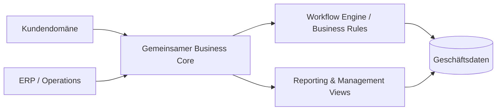

# Enterprise CRM & ERP Platform

### Ein System für Kundenprozesse, interne Workflows und geschäftliche Transparenz

<a href="./README.md">English</a> · <a href="./README.de.md"><strong>Deutsch</strong></a> · <a href="./README.tr.md">Türkçe</a>

---

## ✨ Auf einen Blick

| | |
|---|---|
| 🎯 **Ziel** | Kundennahe Prozesse mit internen Geschäftsabläufen verbinden |
| 🤝 **CRM** | Kundendaten, Beziehungskontext und operative Historie |
| 🏢 **ERP** | Interne Workflows, operative Datensätze und Managementprozesse |
| 📊 **Transparenz** | Zentrales Reporting und bereichsübergreifender operativer Kontext |
| 🧠 **Engineering** | Domänentrennung, gemeinsame Daten, Autorisierung und Workflow-Konsistenz |
| 🚀 **Demo** | Umgebung mit synthetischen Daten geplant |

## 🔎 Überblick

Dieses Projekt wurde als **integrierte Business-Plattform** konzipiert und nicht als Sammlung voneinander getrennter Admin-Seiten.

Die zentrale architektonische Herausforderung besteht darin, CRM- und ERP-Domänen Informationen gemeinsam nutzen zu lassen, ohne die Anwendung eng zu koppeln und langfristig unwartbar zu machen.

## 🧩 Das Problem

Getrennte Systeme verursachen:

- Doppelte und inkonsistente Datensätze
- Fragmentierte Workflows
- Manuelle Datenübertragung
- Schwache Transparenz zwischen Abteilungen
- Schwer wartbares Reporting
- Zunehmende operative Komplexität

## 💡 Der Ansatz

Die Plattform basiert auf einem gemeinsamen operativen Modell, damit zusammengehörige Informationen konsistent zwischen Kunden- und internen Geschäftsprozessen fließen können.

## ⚡ Funktionsübersicht

| CRM-Seite | Gemeinsame Plattform | ERP-Seite |
|---|---|---|
| 👤 Kundendatensätze | 🔐 Autorisierungsgrenzen | 🏢 Interne Abläufe |
| 🧭 Beziehungskontext | 🧱 Gemeinsame Datenmodelle | 🔄 Geschäftsworkflows |
| 🕘 Operative Historie | 🧠 Business Rules | 📋 Administrative Prozesse |
| 🔎 Kundentransparenz | 📊 Reporting | 📈 Operative Transparenz |

## 🧠 Engineering-Fokus

- Enterprise-Anwendungsarchitektur
- Domänentrennung
- Gemeinsame Datenmodellierung
- Konsistenz zwischen Modulen
- Umsetzung von Business Rules
- Workflow-Orchestrierung
- Autorisierungsgrenzen
- Reporting-Architektur
- Langfristige Wartbarkeit

> [!IMPORTANT]
> Das öffentliche Repository ist eine **portfolio-sichere Darstellung**. Produktionszugänge, Kundendaten, interne Unternehmensdaten und Secrets werden nicht veröffentlicht.

## 🎬 Live Demo

**Kommt bald.**

Die Demo wird synthetische Geschäftsdaten und repräsentative Workflows verwenden, damit das System sicher erkundet werden kann.

## 🖼️ Produktvorschau

| CRM-Arbeitsbereich | Operations | Reporting |
|---|---|---|
| 👥 Demnächst | 🏢 Demnächst | 📊 Demnächst |

## 🛣️ Projektstatus

- [x] Portfolio-Repository
- [x] Case-Study-Präsentation
- [x] High-Level-Architektur
- [ ] Quellcode bereinigen
- [ ] Tatsächlichen Tech-Stack dokumentieren
- [ ] Screenshots & Walkthrough-GIF
- [ ] Domänen-/Datenbankdiagramm
- [ ] Öffentliche Demo deployen

## 💡 Warum dieses Projekt wichtig ist

Ein CRM/ERP-System wird anspruchsvoll, sobald mehrere Domänen wie ein einziges Produkt funktionieren müssen.

Der Engineering-Wert liegt nicht nur in CRUD-Funktionalität, sondern im Entwurf **klarer Grenzen, konsistenter Workflows und verlässlicher gemeinsamer Daten** in einem Enterprise-System.

---

### Entwickelt von [Taha Kubilay](https://github.com/tahakubilay)

`Enterprise Software` · `Full-Stack Engineering` · `CRM` · `ERP` · `Workflow Design`

