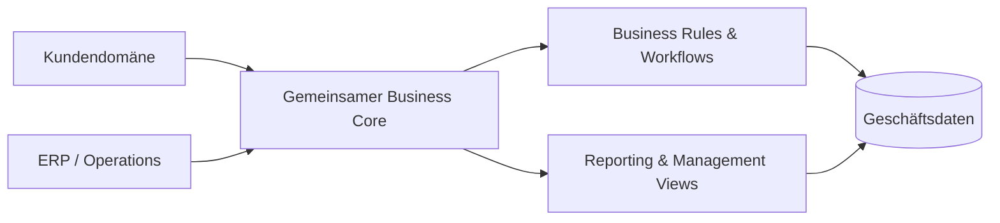

# Enterprise CRM & ERP Platform

### Einheitliche Kundenprozesse, interne Workflows und geschäftliche Transparenz

<a href="./README.md">English</a> · <a href="./README.de.md"><strong>Deutsch</strong></a> · <a href="./README.tr.md">Türkçe</a>

  
  

---

## Überblick

Die Enterprise CRM & ERP Platform verbindet kundennahe Abläufe und interne Geschäftsprozesse in einer gemeinsamen Managementumgebung.

Das System basiert auf einem gemeinsamen Business Core, damit Kundendaten, operative Workflows, administrative Prozesse und Reporting über unterschiedliche Unternehmensbereiche hinweg konsistent bleiben.

## Das Problem

Getrennte Geschäftssysteme führen häufig zu:

- Doppelten oder inkonsistenten Datensätzen
- Fragmentierten Workflows
- Manueller Datenübertragung
- Geringer Transparenz zwischen Abteilungen
- Komplexem Reporting
- Zu enger Kopplung zwischen unabhängigen Prozessen

## Architektur

## Kernfunktionen

| Bereich | Zweck |
|---|---|
| **Kundenmanagement** | Kunden- und Beziehungskontext verwalten |
| **Operative Workflows** | Interne Geschäftsprozesse koordinieren |
| **Gemeinsames Datenmodell** | Zusammengehörige Informationen modulübergreifend konsistent halten |
| **Autorisierung** | Zugriffe nach Rolle und Verantwortung trennen |
| **Reporting** | Bereichsübergreifende operative Transparenz schaffen |
| **Administration** | Managementprozesse zentralisieren |

## Engineering-Fokus

Das Projekt konzentriert sich auf die architektonischen Herausforderungen, die entstehen, wenn CRM- und ERP-Funktionen als ein kohärentes Produkt zusammenarbeiten müssen.

Schwerpunkte:

- Domänentrennung
- Gemeinsame Datenmodellierung
- Konsistenz zwischen Modulen
- Umsetzung von Business Rules
- Workflow-Orchestrierung
- Autorisierungsgrenzen
- Reporting-Architektur
- Langfristige Wartbarkeit

## Daten & Datenschutz

Das öffentliche Repository enthält keine Produktionszugänge, Kundendaten, privaten Unternehmensdaten oder internen Secrets.

---

### Entwickelt von [Taha Kubilay](https://github.com/tahakubilay)

`Enterprise Software` · `CRM` · `ERP` · `Workflow Design` · `Full-Stack Engineering`

