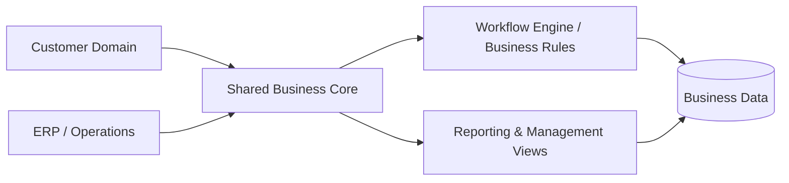

# Enterprise CRM & ERP Platform

### One system for customer operations, internal workflows and business visibility

<a href="./README.md"><strong>English</strong></a> · <a href="./README.de.md">Deutsch</a> · <a href="./README.tr.md">Türkçe</a>

 

  
  
  
  

 

---

## ✨ At a Glance

| | |
|---|---|
| 🎯 **Goal** | Connect customer-facing operations with internal business processes |
| 🤝 **CRM** | Customer records, relationship context and operational history |
| 🏢 **ERP** | Internal workflows, operational records and management processes |
| 📊 **Visibility** | Centralized reporting and cross-domain operational context |
| 🧠 **Engineering** | Domain separation, shared data, authorization and workflow consistency |
| 🚀 **Demo** | Synthetic-data environment planned |

## 🔎 Overview

This project was designed as a **combined business platform**, not a set of disconnected admin pages.

The core architectural challenge is making CRM and ERP domains share information without turning the application into tightly coupled, unmaintainable code.

## 🧩 The Problem

Disconnected systems create:

- Duplicate and inconsistent records
- Fragmented workflows
- Manual data transfer
- Weak cross-department visibility
- Hard-to-maintain reporting
- Increasing operational complexity

## 💡 The Approach

The platform is structured around a shared operational model so related information can move consistently between customer and internal business workflows.

## ⚡ Capability Map

| CRM Side | Shared Platform | ERP Side |
|---|---|---|
| 👤 Customer records | 🔐 Authorization boundaries | 🏢 Internal operations |
| 🧭 Relationship context | 🧱 Shared data models | 🔄 Business workflows |
| 🕘 Operational history | 🧠 Business rules | 📋 Administrative processes |
| 🔎 Customer visibility | 📊 Reporting | 📈 Operational visibility |

## 🧠 Engineering Focus

This project demonstrates work around:

- Enterprise application architecture
- Domain separation
- Shared data modelling
- Cross-module consistency
- Business-rule implementation
- Workflow orchestration
- Authorization boundaries
- Reporting architecture
- Long-term maintainability

> [!IMPORTANT]
> The public repository is a **portfolio-safe representation**. Production credentials, customer records, private company data and internal secrets will not be exposed.

## 🎬 Live Demo

**Coming soon.**

The demo will use synthetic business records and representative workflows so the system can be explored safely.

## 🖼️ Product Showcase

| CRM Workspace | Operations | Reporting |
|---|---|---|
| 👥 Coming soon | 🏢 Coming soon | 📊 Coming soon |

A short animated walkthrough will be added after the public-safe build is prepared.

## 🛣️ Project Status

- [x] Portfolio repository
- [x] Case-study presentation
- [x] High-level architecture
- [ ] Source-code sanitization
- [ ] Real tech stack documentation
- [ ] Screenshots & walkthrough GIF
- [ ] Domain / database diagram
- [ ] Public demo deployment

## 💡 Why This Project Matters

A CRM/ERP system becomes difficult when multiple domains must behave like one product.

The engineering value here is not simply CRUD functionality; it is designing **clear boundaries, consistent workflows and reliable shared data** across an enterprise system.

---

### Built by [Taha Kubilay](https://github.com/tahakubilay)

`Enterprise Software` · `Full-Stack Engineering` · `CRM` · `ERP` · `Workflow Design`

[⬆ Back to top](#enterprise-crm--erp-platform)

