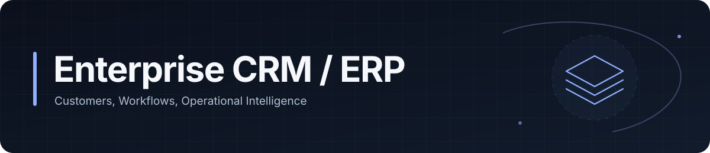
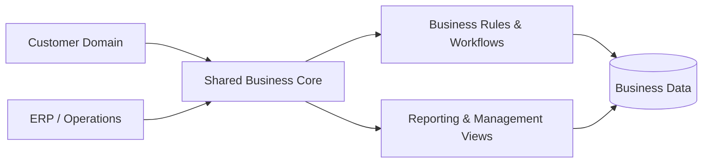

# Enterprise CRM & ERP Platform

### Unified customer operations, internal workflows and business visibility

<a href="./README.md"><strong>English</strong></a> · <a href="./README.de.md">Deutsch</a> · <a href="./README.tr.md">Türkçe</a>

  
  

---

## Overview

Enterprise CRM & ERP Platform brings customer-facing operations and internal business processes into one management environment.

The system is designed around a shared business core so customer records, operational workflows, administrative processes and reporting can remain consistent across different parts of the organization.

## The Problem

Disconnected business systems often create:

- Duplicate or inconsistent records
- Fragmented workflows
- Manual data transfer
- Weak visibility across departments
- Reporting complexity
- Tight coupling between unrelated processes

## Architecture

## Core Capabilities

| Area | Purpose |
|---|---|
| **Customer Management** | Maintain customer and relationship context |
| **Operational Workflows** | Coordinate internal business processes |
| **Shared Data Model** | Keep related information consistent across modules |
| **Authorization** | Separate access by responsibility and role |
| **Reporting** | Provide cross-domain operational visibility |
| **Administrative Processes** | Centralize management workflows |

## Engineering Focus

This project focuses on the architectural challenges that appear when CRM and ERP capabilities must behave as one coherent product.

Key concerns include:

- Domain separation
- Shared data modelling
- Cross-module consistency
- Business-rule implementation
- Workflow orchestration
- Authorization boundaries
- Reporting architecture
- Long-term maintainability

## Data & Privacy

The public repository does not contain production credentials, customer records, private company data or internal secrets.

---

### Built by [Taha Kubilay](https://github.com/tahakubilay)

`Enterprise Software` · `CRM` · `ERP` · `Workflow Design` · `Full-Stack Engineering`

