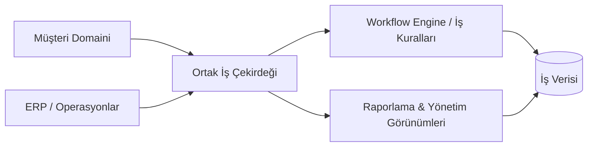

# Enterprise CRM & ERP Platformu

### Müşteri operasyonları, iç iş akışları ve iş görünürlüğü için tek sistem

<a href="./README.md">English</a> · <a href="./README.de.md">Deutsch</a> · <a href="./README.tr.md"><strong>Türkçe</strong></a>

---

## ✨ Kısaca

| | |
|---|---|
| 🎯 **Hedef** | Müşteri tarafındaki operasyonları iç iş süreçleriyle bağlamak |
| 🤝 **CRM** | Müşteri kayıtları, ilişki bağlamı ve operasyon geçmişi |
| 🏢 **ERP** | İç iş akışları, operasyon kayıtları ve yönetim süreçleri |
| 📊 **Görünürlük** | Merkezi raporlama ve alanlar arası operasyonel bağlam |
| 🧠 **Mühendislik** | Domain ayrımı, ortak veri, yetkilendirme ve workflow tutarlılığı |
| 🚀 **Demo** | Sentetik veri ortamı planlanıyor |

## 🔎 Genel Bakış

Bu proje birbirinden kopuk admin ekranları değil, **birleşik bir iş yönetim platformu** olarak tasarlandı.

Temel mimari zorluk, CRM ve ERP domainlerinin bilgi paylaşmasını sağlarken uygulamayı sıkı bağlı ve bakımı zor bir yapıya dönüştürmemektir.

## 🧩 Problem

Birbirinden kopuk sistemler şunlara yol açar:

- Tekrarlanan ve tutarsız kayıtlar
- Parçalı workflow'lar
- Manuel veri taşıma
- Departmanlar arası düşük görünürlük
- Bakımı zor raporlama
- Artan operasyonel karmaşıklık

## 💡 Yaklaşım

Platform, ilişkili bilgilerin müşteri ve iç iş süreçleri arasında tutarlı biçimde akabilmesi için ortak bir operasyon modeli etrafında yapılandırılmıştır.

## ⚡ Yetenek Haritası

| CRM Tarafı | Ortak Platform | ERP Tarafı |
|---|---|---|
| 👤 Müşteri kayıtları | 🔐 Yetkilendirme sınırları | 🏢 İç operasyonlar |
| 🧭 İlişki bağlamı | 🧱 Ortak veri modelleri | 🔄 İş workflow'ları |
| 🕘 Operasyon geçmişi | 🧠 İş kuralları | 📋 Yönetim süreçleri |
| 🔎 Müşteri görünürlüğü | 📊 Raporlama | 📈 Operasyonel görünürlük |

## 🧠 Mühendislik Odağı

- Enterprise uygulama mimarisi
- Domain ayrımı
- Ortak veri modelleme
- Modüller arası tutarlılık
- İş kuralı uygulama
- Workflow orkestrasyonu
- Yetkilendirme sınırları
- Raporlama mimarisi
- Uzun vadeli sürdürülebilirlik

> [!IMPORTANT]
> Public repo **portföye güvenli bir temsildir**. Production kimlik bilgileri, müşteri kayıtları, özel şirket verileri ve iç secret'lar yayınlanmayacaktır.

## 🎬 Canlı Demo

**Yakında.**

Demo, sistemin güvenli biçimde incelenebilmesi için sentetik iş kayıtları ve örnek workflow'lar kullanacaktır.

## 🖼️ Ürün Vitrini

| CRM Çalışma Alanı | Operasyonlar | Raporlama |
|---|---|---|
| 👥 Yakında | 🏢 Yakında | 📊 Yakında |

## 🛣️ Proje Durumu

- [x] Portföy reposu
- [x] Case-study sunumu
- [x] High-level mimari
- [ ] Kaynak kod temizliği
- [ ] Gerçek tech stack dokümantasyonu
- [ ] Ekran görüntüleri & walkthrough GIF
- [ ] Domain / veritabanı diyagramı
- [ ] Public demo deployment

## 💡 Bu Proje Neden Önemli?

Bir CRM/ERP sistemi, birden fazla domain tek bir ürün gibi davranmak zorunda olduğunda karmaşıklaşır.

Buradaki mühendislik değeri yalnızca CRUD işlevleri değildir; enterprise sistem genelinde **net sınırlar, tutarlı workflow'lar ve güvenilir ortak veri** tasarlamaktır.

---

### Geliştiren: [Taha Kubilay](https://github.com/tahakubilay)

`Enterprise Software` · `Full-Stack Engineering` · `CRM` · `ERP` · `Workflow Design`

