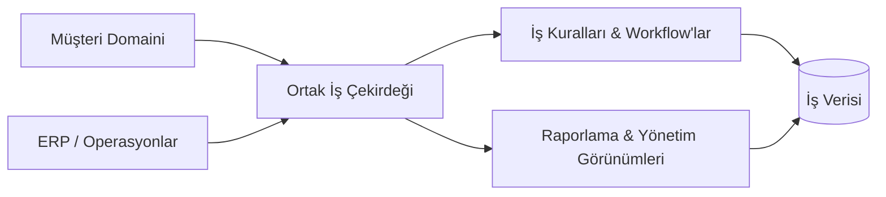

# Enterprise CRM & ERP Platformu

### Müşteri operasyonları, iç iş akışları ve iş görünürlüğünü tek yapıda birleştiren platform

<a href="./README.md">English</a> · <a href="./README.de.md">Deutsch</a> · <a href="./README.tr.md"><strong>Türkçe</strong></a>

  
  

---

## Genel Bakış

Enterprise CRM & ERP Platformu, müşteri tarafındaki operasyonlarla iç iş süreçlerini ortak bir yönetim ortamında birleştirir.

Sistem; müşteri kayıtları, operasyonel workflow'lar, yönetim süreçleri ve raporlamanın farklı modüller arasında tutarlı kalabilmesi için ortak bir iş çekirdeği etrafında tasarlanmıştır.

## Problem

Birbirinden kopuk iş sistemleri genellikle şunlara yol açar:

- Tekrarlanan veya tutarsız kayıtlar
- Parçalı workflow'lar
- Manuel veri aktarımı
- Departmanlar arası düşük görünürlük
- Karmaşık raporlama
- Bağımsız süreçler arasında gereksiz sıkı bağlılık

## Mimari

## Temel Yetenekler

| Alan | Amaç |
|---|---|
| **Müşteri Yönetimi** | Müşteri ve ilişki bağlamını yönetmek |
| **Operasyonel Workflow'lar** | İç iş süreçlerini koordine etmek |
| **Ortak Veri Modeli** | İlgili bilgileri modüller arasında tutarlı tutmak |
| **Yetkilendirme** | Erişimi rol ve sorumluluğa göre ayırmak |
| **Raporlama** | Domainler arası operasyonel görünürlük sağlamak |
| **Yönetim Süreçleri** | İdari iş akışlarını merkezileştirmek |

## Mühendislik Odağı

Bu proje, CRM ve ERP yeteneklerinin tek bir ürün gibi çalışması gerektiğinde ortaya çıkan mimari problemlere odaklanır.

Başlıca konular:

- Domain ayrımı
- Ortak veri modelleme
- Modüller arası tutarlılık
- İş kuralı uygulama
- Workflow orkestrasyonu
- Yetkilendirme sınırları
- Raporlama mimarisi
- Uzun vadeli sürdürülebilirlik

## Veri & Gizlilik

Public repository production kimlik bilgileri, müşteri kayıtları, özel şirket verileri veya iç secret'lar içermez.

---

### Geliştiren: [Taha Kubilay](https://github.com/tahakubilay)

`Enterprise Software` · `CRM` · `ERP` · `Workflow Design` · `Full-Stack Engineering`

